# Awesome-Geospatial-GIS-Minecraft-World-Importers

  

  

  

  

  

  

# 🌍 Top Geospatial GIS & Minecraft World Importers

**Curated List of SaaS/Commercial Platforms & Open-Source GitHub Projects**  

*Focused on Real-World DEM/LiDAR/OSM-to-Minecraft World Generators (RealWorldMC, Arnis, TerraPlusPlus, GeoBox), Minecraft Region/NBT Editors (Amulet, WorldPainter) & Open GIS Data Engines (QGIS, GDAL, Overture Maps)*  

**Last updated: November 2026**

This repository tracks notable **SaaS/Commercial platforms** and **open-source projects** for **Geospatial GIS & Minecraft World Importers**. These tools power 1:1 real-world city, elevation DEM, LiDAR, and OpenStreetMap terrain generation inside Minecraft (`teddy563/realworldmc`, `Arnis`, `TerraPlusPlus`, `GeoBox`), programmatic Anvil `.mca` / NBT world manipulation (`Amulet-Map-Editor`, `anvil-parser`, `WorldPainter`), and global GIS/satellite data sourcing (`QGIS`, `GDAL`, `Overture Maps`, `OpenTopography`) for urban planners, educators, Build The Earth builders, and geospatial developers.

**Examples** include Google Earth Engine (Google), ArcGIS Online (Esri), Nearmap (Thoma Bravo), Mapbox, Planet Insights / Sentinel Hub (Planet Labs), CARTO, Felt, QGIS Cloud (Sourcepole), and Placemark (the category leaders).

**🚀 Open-source emphasis**: This section is heavily expanded with every major active project for real-world GIS-to-Minecraft importers (`teddy563/realworldmc`, `Arnis`, `TerraPlusPlus`, `GeoBox`, `minecraft-earth-map`), Minecraft world & Anvil `.mca` editors (`Amulet-Map-Editor`, `WorldPainter`, `Chunky`, `Bluemap`), and open-source GIS/DEM/LiDAR toolkits (`QGIS`, `GDAL`, `PDAL`, `Overture Maps`, `OpenStreetMap`) — ideal for transforming real-world cities, national parks, and bathymetry into playable 3D voxel worlds.

🤝 Contributions welcome! Open a PR to add/update entries. Keep descriptions factual and link to official sites.

## 📑 Table of Contents

- [📊 Sector Overview & Market Dynamics](#-sector-overview--market-dynamics)

- [☁️ SaaS/Hosted & Commercial Platforms](#️-saashosted--commercial-platforms)

- [💻 Open-Source GitHub Projects](#-open-source-github-projects)

- [🛠️ How to Contribute](#️-how-to-contribute)

- [⚠️ Disclaimer](#️-disclaimer)

- [💖 Support & Thank You](#-support--thank-you)

## 📊 Sector Overview & Market Dynamics

The global Geographic Information Systems (GIS) and spatial analytics market is estimated at approximately **$12.8B to $16.6B in 2026** (scaling toward $30B+ by the early 2030s at an ~11%–14% CAGR). Market dynamics reflect a **bifurcated structure**: the enterprise platform and foundational cloud spatial layer is **moderately concentrated** around entrenched giants (notably Esri and Alphabet/Google Earth Engine), whereas downstream data sourcing, drone/aerial capture, GeoAI processing, and 3D voxel/Minecraft world-generation tooling remain **highly fragmented** across specialized niche SaaS providers, independent data vendors, and open-source developer communities.

## ☁️ SaaS/Hosted & Commercial Platforms

*Sorted descending by company scale (valuation / annual revenue).*

| Platform | Description | Company Scale (Valuation / Revenue) | Starting Paid Tier | Free Tier / Trial Limit |
| :--- | :--- | :--- | :--- | :--- |
| **[Google Earth Engine](https://google.com)** | Planetary-scale cloud geospatial analysis platform combining petabytes of DEM elevation, land-cover, and satellite imagery exportable for voxel terrain modeling. | **Alphabet Inc. subsidiary** (~$350B+ annual revenue; ~$2T+ market cap) | **$500 / month** (Basic commercial tier; on-demand EECU batch compute at $0.40/EECU-hr and online compute at $1.33/EECU-hr) | **Forever Free Non-Commercial Tier** (Community tier with 150 EECU-hours/month; Contributor tier with 1,000 EECU-hours/month for research/education) |
| **[ArcGIS Online (Esri)](https://arcgis.com)** | Enterprise cloud GIS platform offering global elevation layers, 3D building footprints, and geoprocessing workflows used in municipal Minecraft urban planning. | **~$2.0B+ Annual Revenue** (Privately held market leader) | **$125 / user / year** (Viewer user type; full GIS Creator plan at $700 / user / year) | **21-Day Free Trial** (Full-access organizational account with up to 5 named users and 200 service credits; plus free public non-commercial developer account with 2,000,000 basemap tiles/month) |
| **[Mapbox](https://mapbox.com)** | Cloud location platform providing global Terrain-RGB elevation tiles, vector building heights, and Satellite APIs frequently ingested by Minecraft world generators. | **~$1.0B–$1.2B Valuation** (~$150M+ ARR; backed by SoftBank) | **$0.25 per 1,000 requests** (Pay-as-you-go billing above free threshold for raster/elevation tiles; vector tiles at $0.25–$0.50/1k loads) | **Forever Free Tier** (**50,000 free web map loads/month**, up to 200,000 tile requests, and generous free API requests every month) |
| **[Planet Insights / Sentinel Hub (Planet Labs)](https://planet.com)** | Cloud Earth-observation platform and Sentinel Hub API providing global Copernicus DEM elevation, Sentinel-2 land cover, and NDVI vegetation indices. | **~$1.0B Market Cap** (~$220M+ annual revenue; NYSE: PL) | **€25 / month** (€30/month billed monthly for Sentinel Hub Exploration plan with 30,000 processing units) | **30-Day Free Trial** (Full Sentinel Hub API and EO Browser access with Copernicus DEM, Sentinel-2 processing, and custom evalscripts) |
| **[Nearmap (Thoma Bravo)](https://nearmap.com)** | Ultra-high-resolution aerial orthomosaic, DSM/DEM elevation, and 3D reality mesh SaaS used for detailed real-world building and terrain reconstruction. | **~$730M Valuation** (Acquired by Thoma Bravo; ~$150M+ ARR) | **~$3,000 / year** (Starting annual subscription package for single-user/small geographic coverage; enterprise tiers scale above $10,000+/year) | **7 to 14-Day Sales-Assisted Evaluation Trial** (Custom proof-of-concept trial granted by sales upon demo request with bounded tile/download limits; no self-serve free tier) |
| **[CARTO](https://carto.com)** | Cloud-native spatial analytics platform running directly on Snowflake, BigQuery, and PostgreSQL for querying large-scale building and land-use datasets. | **~$150M–$200M Valuation** ($61M+ Series C led by Insight Partners) | **$199 / month** ($299/month billed monthly for Starter cloud workspace with 1 editor and 10 viewers) | **14-Day Free Trial** (Full-featured access to CARTO Builder, spatial SQL workflows, and cloud data warehouse connectors; no credit card required) |
| **[Felt](https://felt.com)** | Collaborative browser-native GIS and internet mapping platform for outlining target real-world bounding boxes, styling GeoJSON layers, and sharing project maps. | **~$50M–$100M Valuation** ($34M+ VC funding led by Bain Capital & Footwork) | **$200 / month** ($240/month billed monthly for Team tier including 5 editor seats) | **Forever Free Starter Tier** (**Unlimited maps**, up to **3 editors**, 100 MB file upload limit per dataset, and full GeoJSON export capabilities) |
| **[QGIS Cloud (Sourcepole)](https://qgiscloud.com)** | Hosted cloud Web-GIS publishing service letting users share and inspect desktop QGIS DEM/OSM preparation layers online with collaborators. | **~$1M–$5M Bootstrapped Scale** (Sourcepole AG; boutique core QGIS contributor firm with ~9 engineers) | **€65 / month** (QGIS Cloud Pro with unlimited private databases, custom domain, and Web-GIS map services) | **Forever Free Community Tier** (**Unlimited public maps**, 1 PostGIS database, and up to **50 MB data storage**) |

## 💻 Open-Source GitHub Projects

| Project | License / Hosting Cost | Free Tier / Self-Hosted Limit | Description |

| :--- | :--- | :--- | :--- |

| **[RealWorldMC (`teddy563/realworldmc`)](https://github.com)** | **Open-Source** ($0 local real-world GIS-to-Minecraft world generator) | **100% Free forever** (Unlimited real-world elevation, map data, and custom Minecraft world generation locally) | Open-source real-world GIS-to-Minecraft importer converting geographic elevation and spatial map datasets into playable Minecraft worlds. |
